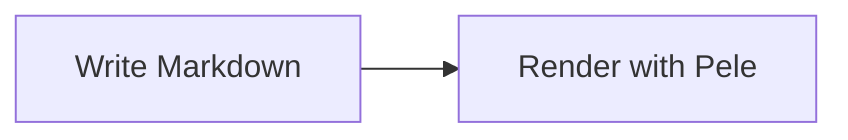

# @aaron212/astro-pele

Render Mermaid diagrams with [Pele](https://pele.run/), Obsidian's Mermaid renderer, in Astro and Sätteri.
The Astro component and Markdown integration render
diagrams in the browser using [`pele/lazy`](https://pele.run/api#mount), loading diagram
types on demand, with responsive layout and Pele's default zoom controls. Until rendering completes, diagrams occupy a
blank box rather than displaying Mermaid source. This browser integration requires JavaScript.

## Astro component

Install the package with `pnpm add @aaron212/astro-pele`, then import the component in an Astro page or MDX file:

```astro
---
import Mermaid from "@aaron212/astro-pele/components/Mermaid.astro";
---

<Mermaid
  code={`flowchart LR
  A[Write Mermaid] --> B[Render with Pele]`}
  fontSize={18}
/>
```

You can also pass source through the default slot:

```astro
<Mermaid>{`sequenceDiagram
  Alice->>Bob: Hello!`}</Mermaid>
```

The `code` prop takes precedence over the slot, including when empty. Slot text is HTML-decoded before rendering;
prefer a string expression for Mermaid syntax containing arrows, angle brackets, or braces.

The component accepts the JSON-serializable Pele mount options described below as props and an optional `class`
for its `.astro-pele` container. Component props override integration options for that diagram.
No integration or Sätteri processor is required. The component bundles the browser mounting runtime automatically,
including responsive layout, zoom controls, and cleanup during Astro client navigation.

## Astro

Install the package in an Astro project:

```sh
pnpm add @aaron212/astro-pele @astrojs/markdown-satteri
```

For local development before publication, build this package and install it using `pnpm add /path/to/astro-pele` instead.
Configure `astro.config.ts`:

```ts
import { satteri } from "@astrojs/markdown-satteri";
import pele from "@aaron212/astro-pele";
import { defineConfig } from "astro/config";

export default defineConfig({
  markdown: {
    processor: satteri(),
  },
  integrations: [pele()],
});
```

Write Mermaid fenced code blocks in Markdown:

````md

````

The integration preserves existing Sätteri options and plugins, bypasses syntax highlighting for Mermaid fences, and
bundles the browser renderer automatically. Other code blocks keep their usual highlighting. MDX uses the same plugins
when it inherits Astro's Markdown processor.

Diagrams mount on initial page load and after Astro client navigation. Before a page swap, the integration destroys each
mount to release its observers and event listeners, and cancels pending mounts before they render. Invalid diagrams
display Pele's built-in error message; loading failures display a short error message.

Pele supports a subset of Mermaid; see its [compatibility documentation](https://pele.run/compatibility).

### Options

Pass Pele's rendering and mount options to the integration:

```ts
pele({
  zoom: { controls: false, maxScale: 4 },
  autoDirection: false,
  fontSize: 18,
  config: {
    flowchart: { curve: "linear" },
  },
});
```

Options apply to all diagrams, including after client navigation. Calling `pele()` keeps Pele's defaults.
The package exports the `PeleOptions` type. See Pele's [API documentation](https://pele.run/api#mount) for available
options and defaults.

Integration options must be JSON-serializable; `config` accepts JSON values, and `now` accepts a Unix timestamp in
milliseconds. Function options (`measurer`, `icons`, `onRender`, `onError`, and `sanitize`) are available through the
standalone client API below.

## Standalone Sätteri

The `/satteri` entry point prepares diagram containers without Astro:

````ts
import { peleMdast } from "@aaron212/astro-pele/satteri";
import { markdownToHtml } from "satteri";

const { html } = markdownToHtml("```mermaid\nflowchart LR\n  A --> B\n```", {
  mdastPlugins: [peleMdast()],
});
````

`peleMdast()` keeps Mermaid source in a data attribute on a blank placeholder, outside syntax highlighting. Include the
returned HTML in your page, then bundle this client code with your application's browser entry point:

```ts
import { mountPele } from "@aaron212/astro-pele/client";

const cleanup = mountPele(document, { zoom: false });

// Before removing the diagrams or navigating away in a client-side application:
// cleanup();
```

`mountPele(root?, options?)` mounts uninitialized `.astro-pele[data-pele]` descendants and returns a cleanup function.
It accepts Pele's `MountOptions`, including `zoom`, `onRender`, `onError`, and `sanitize`. Call it after the HTML has been
inserted into the document. The cleanup function is available immediately, even while diagram types are loading.
Cleanup cancels pending mounts, destroys completed mounts, and restores blank placeholders.

## Styling

Pele reads fonts from its container and supports CSS variables for theme colors. For example:

```css
.astro-pele {
  --pele-bg: var(--background);
  --pele-fg: var(--foreground);
  --pele-font: var(--font-body);
}
```

Use your site's own variable names. See Pele's [theming documentation](https://pele.run/theming) for the full list.

The browser integration's placeholder has no reserved height; Pele determines the height when it renders. Without
JavaScript, that container remains blank. This applies to both the Astro component and Markdown diagrams.

## Development

```sh
mise install
mise exec -- pnpm install
mise exec -- pnpm format
mise exec -- pnpm lint
mise exec -- pnpm check
mise exec -- pnpm build
```

`pnpm build` emits JavaScript and type declarations into `dist/`.

The release workflow follows `astro-typlet`: pushing a `v*` tag validates and builds the package, then stages a public npm
release. Configure npm trusted publishing for this repository's `publish.yml` workflow and its `npm` GitHub environment
before releasing.
